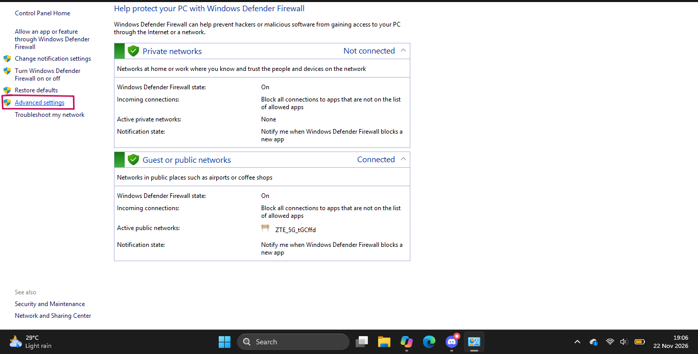
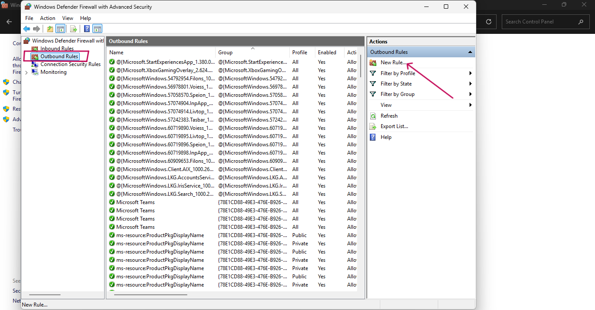
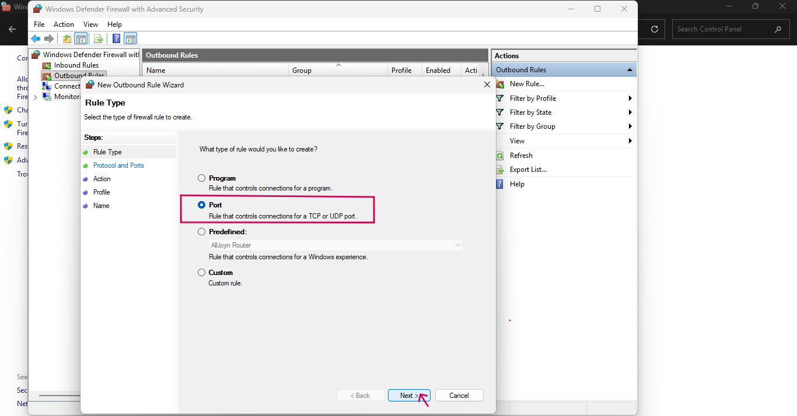
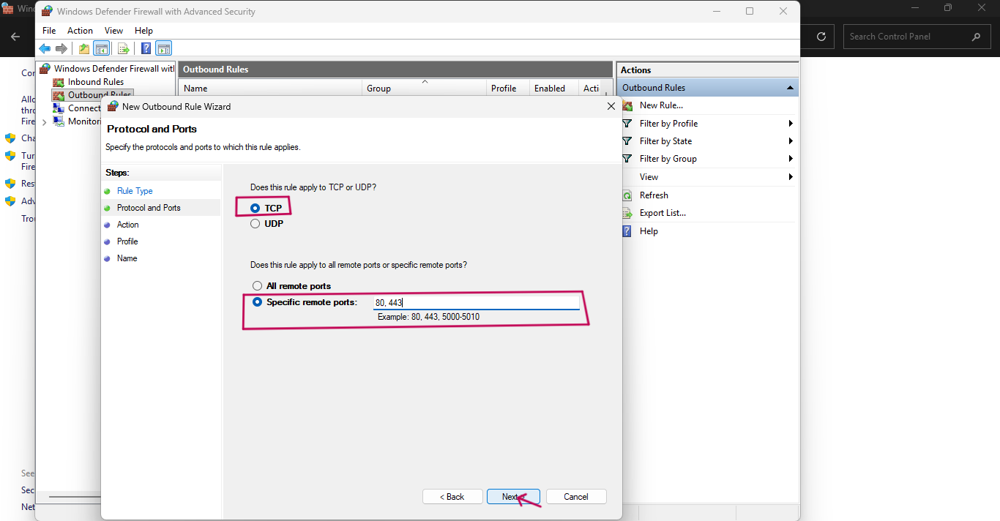
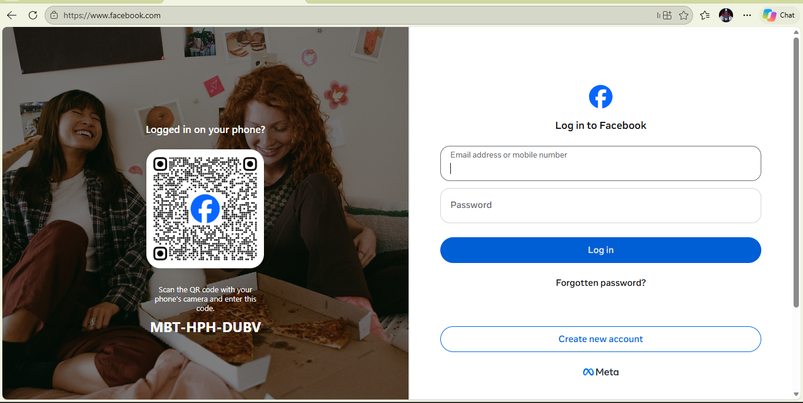
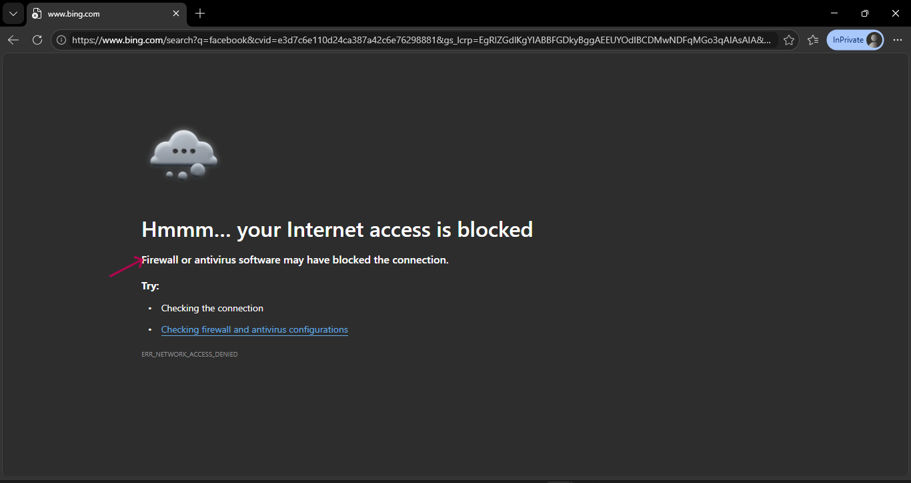
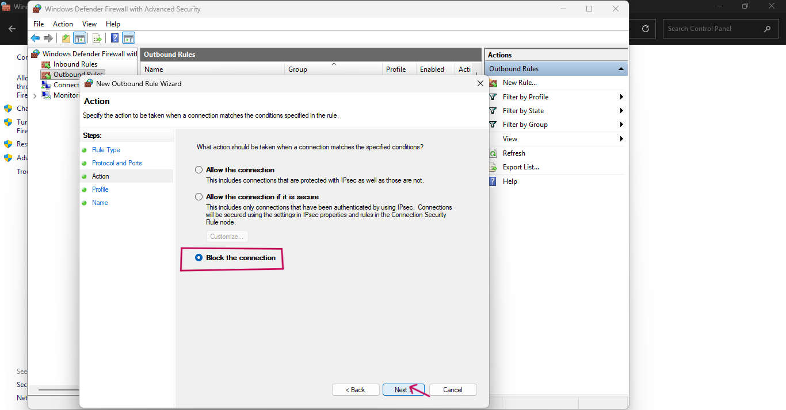
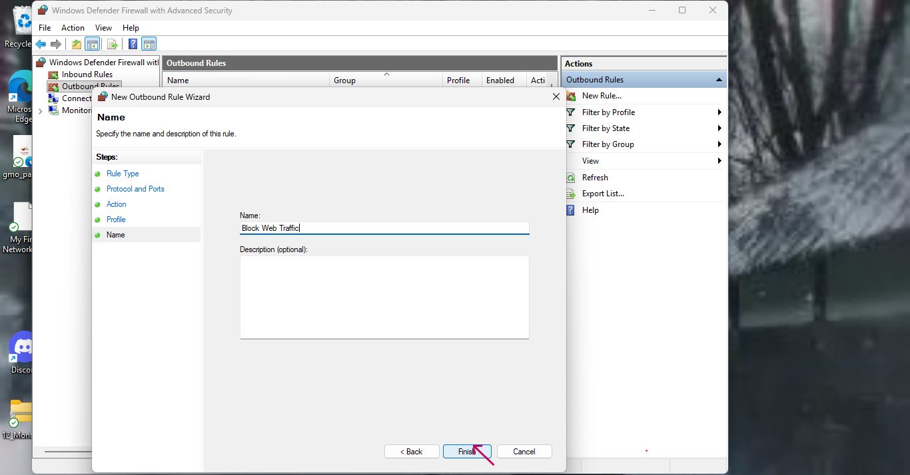

# Windows Defender Firewall Configuration

## About This Project

I carried out this project using Microsoft Defender Firewall on a Windows system to understand 
how a firewall helps protect a computer by controlling incoming and outgoing network connections.

My aim was to learn how to configure firewall settings, create rules, block specific network connections and test how those rules work.

## What I Did

### 1. Firewall Configuration

I opened Windows Defender Firewall with Advanced Security, explored its settings and created new firewall rules to control network traffic.

### 2. Blocking Web Traffic Using Ports

I created a firewall rule to block TCP ports 80 and 443, which are commonly used for HTTP and HTTPS web connections.

---

---
Before applying the rule, I could access Facebook normally. After enabling the rule, I could no longer access it.

---

---

---

---
I also learned that blocking these ports can affect access to other websites because many websites use the same ports.

### 3. Blocking a Specific IP Address

For my second test, I used Command Prompt to ping facebook.com and identify an IP address associated with the domain.

I then opened Windows Defender Firewall, selected New Rule, chose Custom Rule and entered the specific IP address.

After applying the rule, I could no longer access the targeted IP address, while other websites remained accessible.

This helped me understand how firewall rules can be used to block traffic to a specific IP address rather than blocking web traffic generally.

## What I Learned

- How to configure Microsoft Defender Firewall.
- How to create and manage firewall rules.
- How TCP ports 80 and 443 are used for web traffic.
- How to use Command Prompt to identify an IP address.
- The difference between port-based and IP-based firewall rules.
- How to test firewall rules and observe their effects.

## Conclusion

This project gave me practical experience configuring Microsoft Defender Firewall. I learned how to use port-based and IP-based rules to control network traffic and restrict specific connections.
